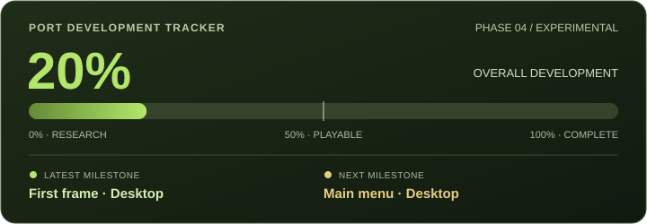
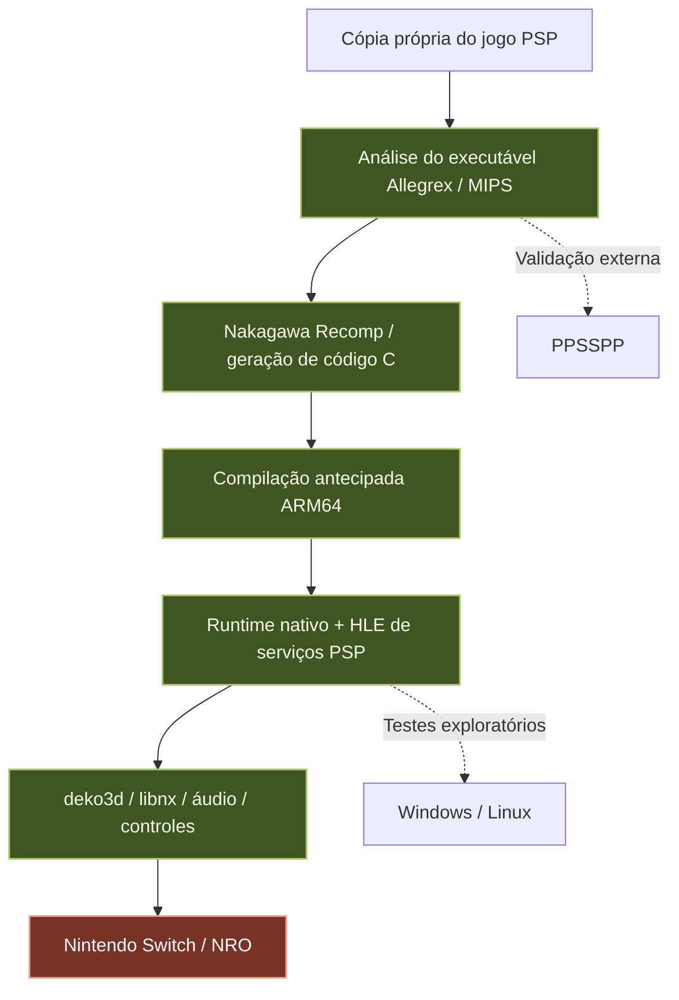

<div align="center">

# 🧅 SHREK RACING NX

### From the swamp to the Switch.

**Recompilação estática de Shrek: Smash n' Crash Racing (PSP) para Nintendo Switch.**


[Visão geral](#-visão-geral) · [Arquitetura](#-arquitetura) · [Progresso](#-progresso) · [Desenvolvimento](#-desenvolvimento) · [Créditos](#-créditos)

**PSP / MIPS Allegrex → C → ARM64 / Nintendo Switch**

</div>

---

> [!WARNING]
> **Projeto experimental em desenvolvimento.** Ainda não existe uma versão jogável ou instalável para usuários. Um ELF/NRO ARM64 foi produzido em laboratório, mas contém caminhos de interpretação e configurações herdadas do Ben 10 NX. Não foi validado em um Nintendo Switch físico e não deve ser distribuído ou instalado como versão funcional do port.

<div align="center">

## 🏁 Port Development Tracker

[](#-progresso)

**20% do desenvolvimento geral · 0% de gameplay validado no Switch físico**

</div>

## 🐸 Visão geral

**Shrek Racing NX** é um projeto independente de engenharia reversa e recompilação estática da versão PSP de *Shrek: Smash n' Crash Racing*.

O objetivo é trazer as corridas do pântano ao Nintendo Switch por meio de um executável nativo ARM64, traduzindo antecipadamente o código MIPS Allegrex do jogo e adaptando os serviços do PSP às interfaces disponíveis no console.

O projeto utiliza o **Nakagawa Recomp** como referência de recompilação e o **Ben 10 NX** como referência de integração nativa com o Switch. A compatibilidade entre as diferentes revisões desses projetos precisa ser demonstrada, não presumida.

| Objetivo | Direção técnica |
| :--- | :--- |
| ⚡ Execução nativa | Recompilação antecipada (AOT), sem JIT ou interpretação de instruções MIPS/VFPU no produto final |
| 🎮 Nintendo Switch | ARM64, libnx e integração experimental com o runtime do Ben 10 NX |
| 🖼️ Renderização | Backend deko3d como alvo no Switch |
| 🔊 Áudio e vídeo | Serviços PSP, ATRAC3+, PSMF/H.264 e sincronização |
| 🧪 Fidelidade | Testes reproduzíveis e comparação com PPSSPP como referência externa |
| 💾 Experiência completa | Controles, saves, estabilidade e desempenho validados em hardware real |

## ⚙️ Arquitetura

O fluxo abaixo representa a arquitetura **pretendida** do produto final, não a ausência comprovada de interpretação nos builds atuais.



> **Strict AOT** significa que as instruções do jogo deverão estar traduzidas antecipadamente. Implementações nativas dos serviços do PSP (HLE) são permitidas; interpretar instruções guest ou recorrer a JIT não atende ao objetivo final. O PPSSPP é uma referência de validação, não parte pretendida do runtime distribuído.

Leia mais em [Arquitetura](docs/ARCHITECTURE.md) e [Matriz de compatibilidade](docs/COMPATIBILITY_MATRIX.md).

## 🚧 Progresso

**Fase atual:** bring-up experimental do runtime, investigação de áudio/vídeo e preparação da integração nativa com o Switch.

| Marco | Estado | Evidência |
| :--- | :---: | :--- |
| Análise do executável PSP | 🟢 | Identificação local do título e análise de relocação |
| Geração de código C | 🟢 | Sete unidades de código e registro gerados e compilados |
| Toolchain ARM64 | 🟢 | Exemplos oficiais Switch compilados |
| Runtime desktop Linux/WSL | 🟡 | Inicialização e execução headless experimental |
| Runtime Windows x86-64 | 🟡 | Build ligado e smoke test com áudio/vídeo dummy |
| Primeiro framebuffer | 🟡 | Logotipo capturado offscreen em 480×272; fidelidade pendente |
| Reprodução das introduções | 🟡 | Sequência de arquivos de vídeo percorrida; menu não confirmado |
| ELF/NRO para Switch | 🟡 | Link experimental; não validado para instalação |
| VFPU strict-AOT | 🟡 | Protótipo isolado para `lv.q` / `sv.q`, sem integração final |
| Áudio ATRAC3+ | 🟠 | Lacuna no decoder em investigação |
| Menu e primeira corrida | ⚪ | Ainda não validados |
| Switch físico, saves e desempenho | ⚪ | Testes pendentes |

🟢 Evidência técnica obtida para o escopo indicado · 🟡 Parcial/experimental · 🟠 Bloqueio em investigação · ⚪ Pendente

### 📊 Como calculamos o percentual

Inspirado na [metodologia do PortWatch VI](https://portwatch-vi.xyz/#method), este indicador usa uma escala própria de marcos acumulativos, adaptada para o objetivo strict-AOT no Nintendo Switch. É uma estimativa editorial, não uma medida de linhas de código, esforço ou tempo restante. Os avanços precisam estar registrados nos relatórios técnicos; um NRO apenas linkado não recebe crédito de inicialização ou gameplay.

<details>
<summary><b>Ver critérios de pontuação (0–100%)</b></summary>

#### Etapa 1 — Do laboratório ao port jogável (50 pontos)

| Marco acumulativo | Pontuação ao atingir | Estado |
| :--- | ---: | :--- |
| Ambiente, análise inicial e geração de código | 5% | ✅ Evidência obtida |
| Executável desktop inicia e executa código do jogo | 10% | ✅ Evidência obtida |
| Primeiro framebuffer com conteúdo reconhecível no desktop | **20%** | ✅ Evidência obtida |
| Menu principal reconhecível no desktop | 25% | ⬜ Pendente |
| Primeira corrida completa e controlável no desktop | 30% | ⬜ Pendente |
| Inicialização do jogo no Switch físico | 35% | ⬜ Pendente |
| Menu funcional no Switch físico | 40% | ⬜ Pendente |
| Primeira corrida completa e controlável no Switch físico, com strict-AOT auditado | 50% | ⬜ Pendente |

Os marcos são cumulativos: atingir uma linha já inclui os pontos anteriores. Marcos incompletos não aumentam a pontuação. O primeiro frame atual é uma captura offscreen experimental, com fidelidade visual não validada.

#### Etapa 2 — Do port jogável ao port completo (50 pontos adicionais)

| Dimensão | Peso máximo | Critério para pontuação integral |
| :--- | ---: | :--- |
| Conteúdo e gameplay | 20 | Modos, pistas e progressão verificáveis no Switch |
| Fidelidade audiovisual | 10 | Renderização, áudio e sincronização validados |
| Desempenho | 10 | Meta de desempenho definida e verificada em hardware real |
| Estabilidade e acabamento | 10 | Sessões prolongadas, controles, saves, instalação reproduzível e ausência de falhas impeditivas |

As dimensões adicionais só pontuam depois do marco jogável strict-AOT (50%). Cada dimensão receberá uma pontuação proporcional baseada em critérios e testes documentados. **Pontuação atual: 20 + 0 = 20%.**

A escala e o gráfico são atualizados manualmente quando novas evidências são registradas. Os números podem ser revistos se uma evidência for invalidada. A referência atual é [Retomada](docs/RESUME.md) e [Progresso](docs/PROGRESS.md).

</details>

### 🎯 Próximos marcos

- [ ] Identificar a origem da recusa ATRAC3+ e validar integridade e alinhamento dos frames.
- [ ] Validar cores, temporização e sincronização audiovisual contra a referência.
- [ ] Chegar ao menu e completar uma corrida no desktop.
- [ ] Integrar e validar a tradução AOT das instruções VFPU restantes.
- [ ] Remover caminhos, configurações e outros acoplamentos específicos do Ben 10.
- [ ] Validar a inicialização e o gameplay no Switch físico.
- [ ] Tornar o ambiente de build reproduzível e validar controles, áudio, saves e estabilidade.

A recusa de decodificação `GHA amplitude mode 0` já foi observada, mas sua relação causal com a pausa na execução ainda não foi demonstrada.

📋 [Relatório de progresso](docs/PROGRESS.md) · [Próximos passos](docs/NEXT_STEPS.md) · [Problemas conhecidos](docs/KNOWN_ISSUES.md)

## 🛠️ Desenvolvimento

### Plataforma e ferramentas

<div align="center">


</div>

| Componente | Função |
| :--- | :--- |
| Nakagawa Recomp | Análise, geração de C e runtime de referência |
| Ben 10 NX | Referência para runtime e backend Switch |
| devkitA64 / libnx | Compilação e integração ARM64 |
| SDL3 / Vulkan | Ferramentas e testes experimentais no desktop |
| PPSSPP | Oráculo externo para comparação de comportamento |
| Python / PowerShell | Automação, testes e diagnóstico |

### Obter o repositório

Com acesso autorizado ao repositório:

```bash
git clone https://github.com/Gustavoxzz/Shrek-Racing-NX.git
cd Shrek-Racing-NX
```

Para retomar o trabalho em outro computador:

```bash
git pull
```

> [!IMPORTANT]
> O clone contém documentação, scripts e patches versionados, **não** o jogo, o código C gerado a partir dele, os runtimes de terceiros ou o ambiente de compilação. A instalação automatizada ainda está pendente. É necessário fornecer localmente uma cópia própria e autorizada do jogo e preparar as dependências nas revisões documentadas.

### Comandos experimentais

Em um ambiente local já preparado, a partir da raiz do projeto no PowerShell:

```powershell
# Testes públicos com fixtures
.\tools\test-public-wsl.ps1

# Build experimental Windows
.\tools\build-windows.ps1 -Jobs 2

# Smoke tests com ISO própria, em ambiente preparado
.\tools\smoke-wsl.ps1 -Iso "CAMINHO_DA_SUA_ISO" -ExitVblank 300 -TimeoutSeconds 20
.\tools\smoke-windows.ps1 -Iso "CAMINHO_DA_SUA_ISO" -ExitVblank 120 -TimeoutSeconds 20
```

Os scripts dependem de ferramentas, referências e entradas privadas preparadas previamente. Não são instaladores, e a aprovação de um smoke test não comprova gameplay ou compatibilidade final.

## 📂 Organização do projeto

```text
Shrek-Racing-NX/
├── docs/          # Arquitetura, evidências, progresso e retomada
├── patches/       # Protótipos e correções experimentais
├── tests/         # Testes públicos do projeto
├── tools/         # Scripts de build, smoke tests e diagnóstico
├── AGENTS.md      # Diretrizes de continuidade
├── LICENSE
└── README.md
```

As pastas `original/`, `references/`, `extracted/`, `generated/`, `build/`, `dist/` e `logs/` permanecem locais e ignoradas pelo Git.

### 📚 Documentação técnica

| Documento | Conteúdo |
| :--- | :--- |
| [Retomada](docs/RESUME.md) | Onde o desenvolvimento parou e por onde continuar |
| [Progresso](docs/PROGRESS.md) | Evidências e resultados por fase |
| [Arquitetura](docs/ARCHITECTURE.md) | Decisões técnicas e requisitos strict-AOT |
| [Ambiente e runtime](docs/RUNTIME_PHASE4.md) | Build desktop, dependências e smoke tests |
| [Integração Switch](docs/SWITCH_PHASE4.md) | Ensaio ARM64 e limitações do NRO |
| [Vídeo e áudio](docs/VIDEO_PHASE4.md) | Primeiro frame, introduções e investigação ATRAC |
| [VFPU AOT](docs/VFPU_AOT_PHASE4.md) | Cobertura, protótipo e testes pendentes |
| [Referências](docs/REFERENCES.md) | Projetos upstream e revisões utilizadas |
| [Roadmap](docs/ROADMAP.md) | Marcos de validação do port |

## 🤝 Contribuição

Contribuições devem priorizar mudanças verificáveis, testes reproduzíveis e documentação de evidências. Bugs e hipóteses precisam permanecer distintos de resultados confirmados.

Antes de trabalhar no projeto, leia [AGENTS.md](AGENTS.md), [Retomada](docs/RESUME.md) e [Problemas conhecidos](docs/KNOWN_ISSUES.md).

Não envie ISOs, executáveis extraídos, código recompilado do jogo, capturas proprietárias, chaves, saves ou logs que contenham dados privados.

## 💚 Créditos

Este projeto se apoia no trabalho de comunidades e projetos independentes:

- [Nakagawa Recomp](https://github.com/Jstar269/Nakagawa-Recomp) — infraestrutura de recompilação e runtime.
- [Ben 10 NX](https://github.com/LaLemniscata/ben10-nx) — referência de port nativo para Nintendo Switch.
- [PPSSPP](https://github.com/hrydgard/ppsspp) — referência externa para investigação de comportamento do PSP.
- [libnx](https://github.com/switchbrew/libnx) e [deko3d](https://github.com/devkitPro/deko3d) — ecossistema de homebrew para Nintendo Switch.

Consulte [THIRD_PARTY_NOTICES.md](THIRD_PARTY_NOTICES.md) para avisos, atribuições e obrigações de licenciamento. A licença incluída neste repositório é a [GNU GPL v3](LICENSE); isso não concede direitos sobre o jogo original ou materiais de terceiros.

**Shrek Racing NX é um projeto não oficial, independente e sem vínculo com os detentores dos direitos do jogo, DreamWorks, Activision, Sony ou Nintendo.** Nenhum conteúdo proprietário do jogo é disponibilizado neste repositório. O projeto requer uma cópia própria e autorizada.

---

<div align="center">

**Ogres have layers. So does a static recompiler.** 🧅

*Do pântano para o código. Do código para o Switch.*

</div>
